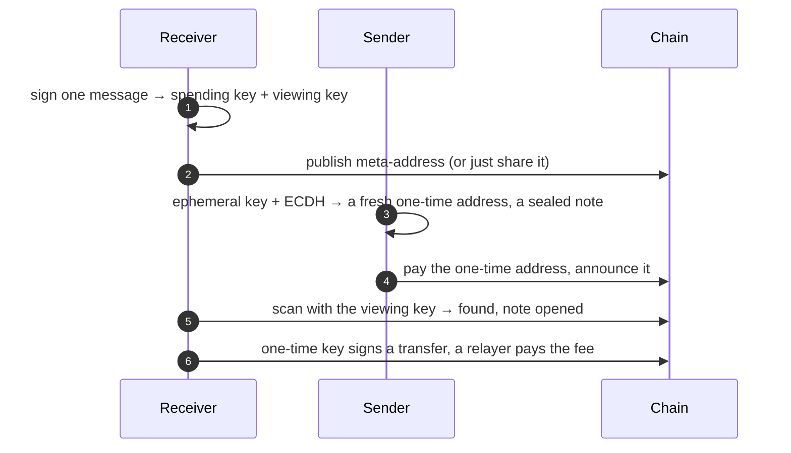

<div align="center">

# stealthkit

**Private payments on any chain.**

Every payment lands at a fresh address only its receiver can find.<br/>
A sealed note says who paid and why. Spending never needs gas.

[](LICENSE)
[](test)
[](#chains)
[](https://eips.ethereum.org/EIPS/eip-5564)

[Quick start](#quick-start) · [How it works](#how-it-works) · [Chains](#chains) · [Privacy model](#what-stays-private) · [Design](DESIGN.md)

</div>

---

On a public chain, one receiving address is a public ledger of your life: every client, every
salary, every sale, forever. **stealthkit** gives every payment its own address. Senders make it
from one string you share; only you can tell it's yours; you spend from it without ever funding it.

It is the privacy layer of [Kova](https://mykova.app), a dollar wallet live on Monad, taken out so
anyone can build it in. One chain-neutral core, a thin adapter per chain:

```
st:eth:0x…  ──►  0x616A0ff1A9c1587005Eb13b488d5219478aaFF35        (any EVM chain)
st:sol:0x…  ──►  9NhcBA9tEP5GKcA6jcPpS5XJoBcNM4QTYEMQPGT6okQk      (Solana)
st:stellar… ──►  GB6GZGZVHKJUL4I7TEVRI44GXA5RHVUZARXL3YYB6A4E345LLTIO3Y3M
```

## Quick start

```bash
npm install stealthkit viem
```

**Receive.** Make keys from a signature your wallet already gives you. Nothing to store.

```ts
import { stealthKeysFromSignature, stealthKeysMessage, stealthMetaAddress } from 'stealthkit/evm'

const signature = await wallet.signMessage({ message: stealthKeysMessage('MyApp', wallet.address) })
const keys = stealthKeysFromSignature(signature)
const meta = stealthMetaAddress(keys) // st:eth:0x… share it, or publish it in ERC-6538
```

**Send.** A fresh address for this payment, and a note only the receiver can read.

```ts
import { announceCalldata, generateStealthPayment } from 'stealthkit/evm'

const payment = generateStealthPayment(meta, { name: 'Ada', note: 'For lunch' })
// pay payment.stealthAddress, then announce it so the receiver can find it:
const data = announceCalldata(payment, token, amount) // → ERC-5564 announcer
```

**Find and spend.** Scan with the viewing key; spend with a signature a relayer submits.

```ts
import { scanAnnouncements, signStealthTransfer, stealthPrivateKey, viewKeyOf } from 'stealthkit/evm'

const [found] = await scanAnnouncements({ client, view: viewKeyOf(keys), fromBlock, toBlock })
const key = stealthPrivateKey(keys, found.ephemeralPublicKey)
const { calldata } = await signStealthTransfer({ stealthPrivateKey: key, token, chainId, to, value })
// a relayer sends calldata and pays the gas; it can't change where the money goes
```

The same three moves on Solana, Sui, Aptos or Stellar, with the chain-neutral core:

```ts
import { createPayment, deriveKeys, findPayment, fromSeed, metaAddress, viewKeyOf } from 'stealthkit'
import { solana } from 'stealthkit/solana'

const keys = deriveKeys(solana, fromSeed(secret))          // a passkey PRF output, a seed…
const payment = createPayment(solana, metaAddress(solana, keys), { memo: { note: 'Rent' } })
findPayment(solana, viewKeyOf(solana, keys), payment)      // → the address, for its owner only
```

Runnable versions of all of it are in [`examples/`](examples).

## How it works



The sender and receiver each compute the same shared secret: the sender from a throwaway key and
the receiver's viewing key, the receiver from its viewing key and the throwaway public key. That
secret moves the receiver's spending key to a new point: a new address, every time.

```
shared = H( e·V ) = H( v·E )        address = S + shared·G        key = s + shared
```

A one-byte **view tag** lets a receiver skip 255 of every 256 other people's payments for the cost of
one hash. A **view key** finds and reads everything and can move nothing: hand it to an accountant.

Full specification, equations and threat model: **[DESIGN.md](DESIGN.md)**.

## Chains

| Chain | Scheme | Address | Announce | Spend without gas |
|---|---|---|---|---|
| **EVM** (Monad, Ethereum, Base, …) | secp256k1, ERC-5564 scheme 1 | `0x…` | ERC-5564 announcer | EIP-3009 (USDC, AUSD) |
| **Solana** | ed25519 | base58 | envelope in a memo | fee payer |
| **Sui** | ed25519 | BLAKE2b(flag ‖ key) | envelope in an event | sponsored transaction |
| **Aptos** | ed25519 | SHA3(key ‖ scheme) | envelope in an event | fee-payer transaction |
| **Stellar** | ed25519 | StrKey `G…` | envelope | claimable balance + fee bump |

One-time keys on the ed25519 chains are raw scalars. stealthkit signs with them directly, and the
signatures verify under standard Ed25519, so a one-time address signs like any account.

**Bring your own chain** in an afternoon: a `ChainAdapter` (how a key becomes an address), the one
function that signs the chain's transaction, and a line in the test vectors. See
[Adding a chain](DESIGN.md#14-adding-a-chain).

## What stays private

| Private | Public |
|---|---|
| Which payments belong to whom | Amounts and assets |
| A receiver's total, and who pays them | That *a* payment went to *a* one-time address |
| The note: who paid and why | A sender paying from their own known wallet |
| The spending key: relayers and indexers never hold it | Links you make by moving funds to a known wallet |

stealthkit hides *who*, not *how much*. Read [the privacy model](DESIGN.md#11-privacy-model) before you
promise users more.

## Built for production

- **In production.** Kova runs this code on Monad for private sends, private receiving and
  payroll. From its test network: a
  [private send with its sealed note](https://testnet.monadscan.com/tx/0x62b66ba678e6373fb963a95e6acd7993c1f7a9237dcf192a22facda913069992),
  [private payroll](https://testnet.monadscan.com/tx/0x7726357cc8a516c6d237ca9e318db16a999f39930d564b97fdb1784e3592d16b),
  and [private funds gathered](https://testnet.monadscan.com/tx/0x240552b39b6156883a32cb82f836be137e2d2f9223ed7e796d6fe2699290081d)
  then [spent](https://testnet.monadscan.com/tx/0xcfdc9845ef1f87442a949615541c51b08dcc8473778bf6581c3125f0af06a85b).
- **Kova-compatible, byte for byte.** A fixture from Kova's own code pins keys, addresses and sealed
  notes, so stealthkit apps and Kova pay each other privately.
- **Conformance vectors.** [`stealthkit-v1.json`](test/vectors/stealthkit-v1.json) fixes every output for
  every chain. A Rust, Go or Swift port is correct when it matches.
- **Hardened.** Every public key is validated on parse (torsion-free on ed25519, so a malicious
  meta-address can't steer a sender into a small subgroup). Notes are bound to their address.
  Signing nonces are deterministic.
- **Small and pure.** No network calls in the core, no native code. Depends on `@noble`, `@scure` and,
  for EVM, `viem`.

## Contracts on Monad

| | Address | |
|---|---|---|
| ERC-5564 announcer | [`0x55649E01B5Df198D18D95b5cc5051630cfD45564`](https://monadscan.com/address/0x55649E01B5Df198D18D95b5cc5051630cfD45564) | mainnet, testnet |
| ERC-6538 registry | [`0x6538E6bf4B0eBd30A8Ea093027Ac2422ce5d6538`](https://monadscan.com/address/0x6538E6bf4B0eBd30A8Ea093027Ac2422ce5d6538) | mainnet |

## Develop

```bash
pnpm install
pnpm test          # 64 tests: every chain, Kova compatibility, conformance vectors
pnpm typecheck
pnpm vectors       # rebuild the conformance vectors
pnpm build && node examples/05-solana.mjs
```

## API

| | `stealthkit` (core) | `stealthkit/evm` |
|---|---|---|
| Keys | `deriveKeys`, `fromSignature`, `fromSeed`, `keysMessage` | `stealthKeysFromSignature`, `stealthKeysMessage` |
| Share | `metaAddress`, `parseMetaAddress`, `encodeViewKey`, `parseViewKey` | `stealthMetaAddress`, `stealthViewKey`, `registerKeysCalldata` |
| Pay | `createPayment`, `encodeEnvelope` | `generateStealthPayment`, `announceCalldata` |
| Find | `findPayment`, `openPaymentMemo`, `decodeEnvelope` | `scanAnnouncements`, `checkStealthAddress`, `openStealthMemo`, `stealthSender` |
| Spend | `paymentPrivateKey`, `signWithScalar` | `stealthPrivateKey`, `signStealthTransfer` |
| Route | `routePayment`, `planPrivateSpend` | |

Chain helpers: `signSolanaMessage` · `signSuiTransaction` · `signAptosTransaction` · `signStellarTransaction`.

## Security

Not yet audited. The cryptography comes from `@noble/curves` and `@noble/hashes` (independently
audited) and `@noble/ciphers`. Please report vulnerabilities privately; see [SECURITY.md](SECURITY.md).

## License

[MIT](LICENSE). Built by the team behind [Kova](https://mykova.app).
