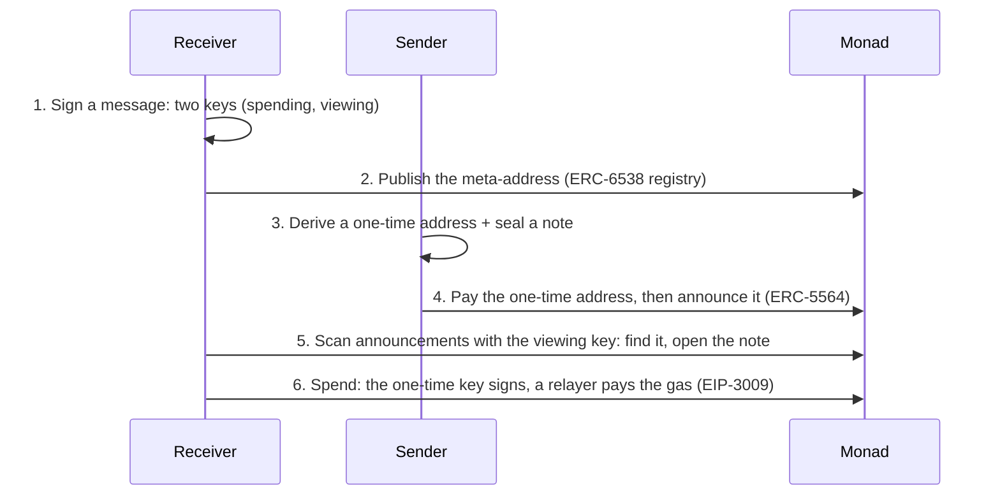

# monad-stealth

**Private payments on Monad.** Every payment lands at a fresh one-time address that only the
receiver can find and open. Nobody watching the chain can tell whose address it is or add someone's
payments up. A sealed note says who paid and why, readable only by the receiver. The receiver
spends without ever holding gas.

This is the privacy layer of [Kova](https://mykova.app), a dollar wallet on Monad, taken out of
Kova so anyone can build it into a wallet, a shop, a payroll tool or an agent. It runs live on
Monad mainnet today, on open standards:

- [ERC-5564](https://eips.ethereum.org/EIPS/eip-5564), stealth addresses (scheme 1: secp256k1 with view tags)
- [ERC-6538](https://eips.ethereum.org/EIPS/eip-6538), a registry of stealth meta-addresses
- [EIP-3009](https://eips.ethereum.org/EIPS/eip-3009), transfers signed off chain, so spending needs no gas

```bash
npm install monad-stealth viem
```

---

## How it works, in six steps



### 1. Two keys from one signature

The receiver's wallet signs a fixed message. The signature's two halves, each hashed under its own
label, become two private keys:

- the **spending key** moves the money
- the **viewing key** finds payments and reads their notes, and can move nothing

EVM wallets sign deterministically (RFC 6979), so the same wallet and message give the same keys on
every device, with nothing to store or back up beyond the wallet itself.

```ts
const signature = await wallet.signMessage({ message: stealthKeysMessage('MyApp', wallet.address) })
const keys = stealthKeysFromSignature(signature)
```

### 2. A meta-address anyone can pay

The two public keys, together, are the **stealth meta-address**: `st:eth:0x<spending><viewing>`.
Share it like a payment link, or publish it in ERC-6538's registry so a sender needs only the
receiver's ordinary wallet address.

```ts
const meta = stealthMetaAddress(keys)
const data = registerKeysCalldata(meta) // send to ERC6538_REGISTRY
```

### 3. A one-time address for every payment

The sender makes a throwaway (ephemeral) key and does an elliptic-curve Diffie–Hellman with the
receiver's viewing public key. Both sides can compute that shared secret; nobody else can.

```
shared  = keccak256( ECDH(ephemeral private, viewing public) )
address = address( spending public + shared · G )
viewTag = first byte of shared
```

The address is new every time, unlinkable to the receiver without the viewing key.

```ts
const payment = generateStealthPayment(meta, { name: 'Ada', note: 'For lunch' })
// payment.stealthAddress, payment.ephemeralPublicKey, payment.viewTag, payment.sealed
```

### 4. Pay it, and announce it

The sender pays the one-time address, then posts an **announcement** to ERC-5564's announcer
contract: the address, the ephemeral public key and the metadata (the view tag, the token, the amount,
and the sealed note). The announcement is how the receiver finds the payment, with no server.

```ts
const data = announceCalldata(payment, token.address, amount) // send to ERC5564_ANNOUNCER
```

### 5. Find payments with the viewing key

The receiver reads the announcer's events. For each one it checks the one-byte view tag first,
which rules out 255 of every 256 other people's payments for the cost of one hash. Then it derives
the address and checks it matches.

```ts
const found = await scanAnnouncements({ client, view: viewKeyOf(keys), fromBlock, toBlock })
const note = openStealthMemo(keys.viewingPrivateKey, found[0]) // { name: 'Ada', note: 'For lunch' }
```

A **view key** (the viewing private key plus the spending public key) does all of this and can't
spend. Give it to an accountant, a tax tool or an auditor.

### 6. Spend without gas

A one-time address holds dollars and no MON. Sending it MON from your wallet would tie the two
together on chain and undo the privacy. So the one-time address's key **signs** an EIP-3009
transfer off chain, and anyone submits it and pays the gas. The token verifies the signature: a
relayer can carry the transfer but can't change where it goes or how much.

```ts
const key = stealthPrivateKey(keys, found[0].ephemeralPublicKey)
const { calldata } = await signStealthTransfer({ stealthPrivateKey: key, token: monad.mainnet.tokens.AUSD, chainId: 143, to, value })
// a relayer sends `calldata` to the token
```

AUSD (Agora) and Circle's USDC both support EIP-3009 on Monad; their addresses and signing domains
are in `monad.mainnet.tokens`.

---

## Sealed notes

A payment can carry a short note: who sent it, their name, a message. It's encrypted with
XChaCha20-Poly1305 under a key hashed from the same ECDH secret as the address, and **bound to the
one-time address** (as associated data). Only the receiver's viewing key opens it, and a note copied
onto another payment won't open.

Who sent it is shown with how sure it is (`stealthSender`):

| Proof | Meaning |
|---|---|
| `chain` | The chain shows the money left that wallet |
| `signed` | The sender's wallet signed for this one-time address (paid from their own private dollars) |
| `claimed` | Only the note says so: show it as unconfirmed |

## The privacy router

Private dollars end up spread across many one-time addresses. `routePayment` decides where each
payment comes from so nobody has to manage that by hand:

1. From one private address that covers it. The change stays there, still private.
2. From the wallet's balance, when that covers it.
3. From several private addresses gathered into one first, only when nothing else pays.
4. As a last resort, just enough private dollars move into the balance. That move is public, so it's kept small.

---

## What stays private, and what doesn't

Be honest with your users about this.

| Private | Not private |
|---|---|
| Which payments belong to which receiver | Amounts (the token transfer is public) |
| A receiver's total, and who pays them | That *a* payment went to *a* one-time address, and when |
| The note: who sent it and why | A sender paying from their own wallet is visible as the sender |
| The receiver's spending key never leaves them | A one-time address spent to a known wallet links the two |
| | Timing: receiving and spending close together can be correlated |

The relayer that submits gasless transfers and the server (if any) that indexes announcements can
**point payments at a receiver but never move them**: neither ever holds a spending key.

## Contracts on Monad

| Contract | Address | Networks |
|---|---|---|
| ERC-5564 announcer | [`0x55649E01B5Df198D18D95b5cc5051630cfD45564`](https://monadscan.com/address/0x55649E01B5Df198D18D95b5cc5051630cfD45564) | mainnet, testnet |
| ERC-6538 registry | [`0x6538E6bf4B0eBd30A8Ea093027Ac2422ce5d6538`](https://monadscan.com/address/0x6538E6bf4B0eBd30A8Ea093027Ac2422ce5d6538) | mainnet |
| AUSD | `0x00000000eFE302BEAA2b3e6e1b18d08D69a9012a` | mainnet |
| USDC | `0x754704Bc059F8C67012fEd69BC8A327a5aafb603` | mainnet |

Both standard contracts sit at the same address on every chain they're deployed to.

## Running on Kova today

These are real transactions from Kova's live use of this code:

- [A private send's announcement, with its sealed note](https://testnet.monadscan.com/tx/0x62b66ba678e6373fb963a95e6acd7993c1f7a9237dcf192a22facda913069992)
- [Private payroll: each person paid at a one-time address](https://testnet.monadscan.com/tx/0x7726357cc8a516c6d237ca9e318db16a999f39930d564b97fdb1784e3592d16b)
- [Two private payments gathered into one address](https://testnet.monadscan.com/tx/0x240552b39b6156883a32cb82f836be137e2d2f9223ed7e796d6fe2699290081d), [then spent](https://testnet.monadscan.com/tx/0xcfdc9845ef1f87442a949615541c51b08dcc8473778bf6581c3125f0af06a85b)

Keys made with this library's default labels are the same keys Kova makes, so your app and Kova can
pay each other privately. `kovaPersonalKeysMessage(wallet)` gives the exact message a Kova wallet
signs. To keep your app's keys separate, pass your own `KeyLabels` and memo label, and never change
them afterwards: different labels make different keys.

## Try it

```bash
git clone https://github.com/Cybire1/monad-stealth && cd monad-stealth
pnpm install
pnpm test                  # 23 tests, including send → announce → find → open → spend
pnpm example:receive       # make keys, see your meta-address and view key
pnpm example:send          # a one-time address, a sealed note, the announcement
pnpm example:scan          # scan Monad mainnet with a view key (VIEW_KEY=…)
pnpm example:spend         # sign a gasless transfer out of a one-time address
```

## API at a glance

| Area | Functions |
|---|---|
| Keys | `stealthKeysMessage`, `stealthKeysFromSignature`, `stealthMetaAddress`, `parseStealthMetaAddress`, `viewKeyOf`, `stealthViewKey`, `parseStealthViewKey` |
| Paying | `generateStealthAddress`, `generateStealthPayment` |
| Finding | `checkStealthAddress`, `scanAnnouncements`, `openStealthMemo`, `stealthSender` |
| Spending | `stealthPrivateKey`, `signStealthTransfer`, `transferWithAuthorizationCalldata` |
| On chain | `ERC5564_ANNOUNCER`, `ERC6538_REGISTRY`, `announceCalldata`, `registerKeysCalldata`, `stealthMetadata`, `parseStealthMetadata`, `metaAddressToBytes`, `metaAddressFromBytes` |
| Routing | `routePayment`, `planPrivateSpend` |

## License

MIT. Built by [Kova](https://mykova.app) on Monad.
